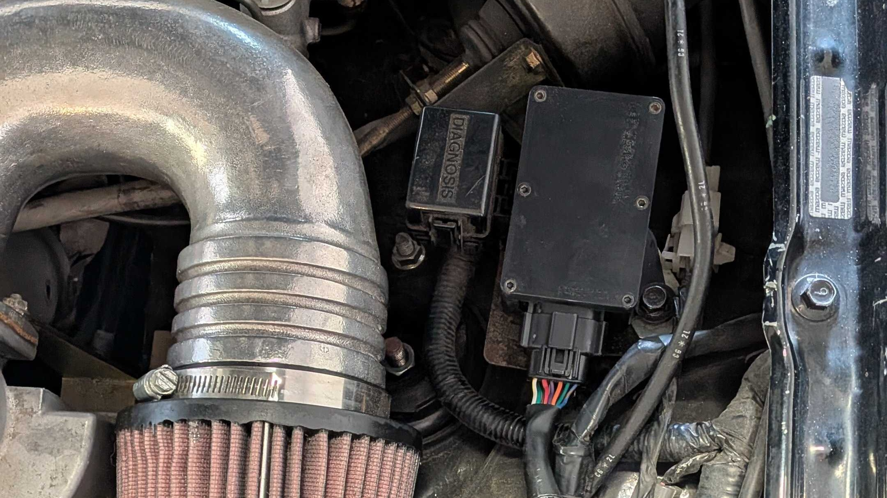

# Installing OpenWink

This guide is for fitting an assembled OpenWink module to a 1989 to 1997 NA Mazda MX5 Miata with pop up headlights. If your module is already installed, continue with [Getting Started](./GETTING_STARTED.md) to install the app and connect.

> [!NOTE]
> Mounting and wiring instructions are still being written. If you need help installing your module, ask in the [Discord server](https://discord.gg/jaP67bgZBM).

## Before Installation

You will need an assembled module with its enclosure and matching wiring harness.

Check that both headlights raise and lower normally with the factory controls before fitting OpenWink. Existing motor or wiring problems will make it harder to tell whether the module is working correctly.

Park the car, turn off the engine and lights, and let the engine bay cool before working around it. Disconnect vehicle power before unplugging or reconnecting headlight wiring, and keep your hands and tools clear of the headlight mechanisms whenever power is connected.

## Module and Harness

OpenWink uses an adapter harness to connect to the factory headlight wiring without cutting or splicing it. Use the harness intended for your module's board revision. The [hardware repository](https://github.com/pyroxenes/openwink-hardware-module) describes the board revisions and their connector changes.

The existing installation uses the exhaust side of the engine bay. This also matches the firmware's default left/right orientation. Keep the module and harness away from exhaust heat, belts, fans, and the moving headlight linkages. Check that connectors are fully seated and that the harness cannot be pinched by the headlights or hood.

## Check the Installation

Once the module and harness are connected and secured, clear your tools from the engine bay and restore power.

1. Use the dashboard retractor button to raise and lower the headlights. Allow each movement to finish before pressing again.
2. Check that the headlights raise when switched on, and that the factory controls still operate as expected.
3. Follow [Getting Started](./GETTING_STARTED.md#connect-to-your-module) to connect the app, then test both headlights and each side individually.
4. Check the harness again with the headlights in both positions. It should stay clear of the linkages throughout their movement.

Left and right normally refer to the view from inside the car. The perspective setting under **Settings → Module Settings** changes this to the view from in front of the car. If commands appear reversed, check both the installation side and this setting.

If a headlight does not move correctly, stop testing and check the connections with power disconnected. Restore the original factory connections if you need to remove OpenWink, then verify the factory controls again. Resolve any problems with normal headlight operation before using the car.
