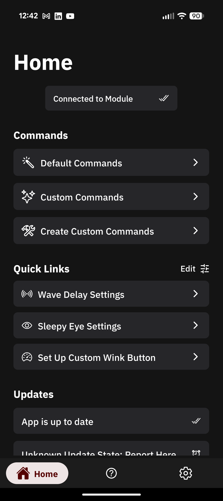

<div align="center">

# Wink Module Remote App

This directory contains the controller application for the OpenWink module system. The app communicates with the Wink Module over Bluetooth Low Energy, providing a modern control center for Miata pop-up headlight commands, custom animations, module settings, OTA firmware updates, and system diagnostics.

[](https://www.typescriptlang.org/)
[](https://reactnative.dev/)
[](https://docs.expo.dev/)

</div>

# Table of Contents
- [App Preview](#app-preview)
- [Core Libraries](#core-libraries-used)
- [Getting Started](#getting-started)
  - [Development](#creating-a-development-artifact)
    - [iOS Development](#creating-a-development-build-for-ios-without-a-developer-account)
  - [Preview](#creating-a-preview-artifact)
- [About the App](#about-the-app)
- [Contributing](#contributing)
  - [Vulnerabilities](#vulnerabilities)

## App Preview


See more about the current state of the app in the app [Gallery](../docs/media/app/gallery.md)!

## Core Libraries Used
```bash
> react-native
> expo
> expo-font
> expo-blur
> @react-navigation/bottom-tabs
> @react-navigation/native-stack
> react-native-ble-plx
```

This React Native project is managed with Expo and EAS, allowing for faster iteration through Expo development builds. Bluetooth Low Energy functionality is provided through `react-native-ble-plx`.

## Getting Started

Android builds are available on the [release page](https://github.com/seasaltsaige/openwink/releases). You can also build the app yourself using the instructions below, which is currently required for iOS. See [Getting Started](../docs/GETTING_STARTED.md) for installation and pairing.

Use the Node.js version in [.nvmrc](./.nvmrc), currently `20.19.5`.

Development builds look for a local update server by default. If you want to check for published updates instead, add this to `openwink-app/.env.local` before starting the development server:

```dotenv
EXPO_PUBLIC_UPDATE_URL=https://update-server.netlify.app/.netlify/functions/api/update
```

This changes the app's update metadata and firmware download requests. Installing app OTA updates requires a release build.

### Creating a development artifact
The app uses native Bluetooth components, so it needs a development build and cannot run in Expo Go. Use a physical phone to test the module connection.

Clone this repository and ensure you are in the correct directory.

```bash
> git clone https://github.com/seasaltsaige/openwink.git
> cd ./openwink/openwink-app
```

Ensure that you have all the relevant packages installed.

```bash
> npm ci
> npm install -g eas-cli # Install global EAS CLI build tools
```

The `development` profile is already defined in [eas.json](./eas.json):

```json
{
  "developmentClient": true,
  "distribution": "internal",
  "env": {
    "APP_VARIANT": "development"
  }
}
```

For a local iOS build without a paid Apple Developer account, skip the EAS account setup below and use the [Xcode instructions](#creating-a-development-build-for-ios-without-a-developer-account).

Make sure you have an [expo.dev](https://expo.dev/) account, and you log into it using the [eas-cli](https://github.com/expo/eas-cli?tab=readme-ov-file#eas-accountlogin).

Create a new project in [Expo](https://expo.dev/).

Login with eas-cli.

```bash
> eas login
```

Create a `.env` file from the `.env.template` and fill in your variables.

```bash
# Won't overwrite if .env already exists
> cp -n .env.template .env
```

Initialize the project.

```bash
> eas init
```

Start your Android build.

```bash
> eas build --profile development --platform android
```

For iOS, use `--platform ios`. EAS builds for a physical iPhone require a paid Apple Developer account and device registration; see [Expo's internal distribution instructions](https://docs.expo.dev/build/internal-distribution/).

Once the build finishes, you will receive a QR code to install the build artifact on your device. Once you do so, you will need to start the development server on your laptop/desktop. Ensure you are connected to the same network on both devices, otherwise you will be unable to connect to the development server.

```bash
> npx expo start --dev-client
```

Happy Coding!

### Creating a development build for iOS without a developer account
You can build locally on a Mac with Xcode using your personal Apple ID. A paid Apple Developer account is not required for this route. See [Expo's local development build instructions](https://docs.expo.dev/develop/development-builds/introduction/?buildenv=build-locally) for signing requirements.

Clone the repository and install the app dependencies as described above. You can skip `eas login`, `eas init`, and the EAS build command for a local build.

Generate the native iOS project files using Expo's prebuild command.

```bash
> npx expo prebuild --platform ios
```

Install CocoaPods dependencies if the prebuild step did not finish installing them.

```bash
> npx pod-install
```

Open the generated `.xcworkspace` file inside `ios/` in Xcode.

**Configure Signing in Xcode**:

1. In Xcode's project navigator, select the OpenWink app target.
2. Navigate to the **Signing & Capabilities** tab.
3. Under **Team**, select your personal Apple ID team.
4. Use a bundle identifier you can sign with your account, and let Xcode manage signing automatically.

Connect your iPhone, select it as the run destination, and use **Product → Run** to build and install the app. Follow any device trust or Developer Mode prompts.

From `openwink-app`, start the Expo development server.

```bash
> npx expo start --dev-client
```

Your device should now connect to the development server. Ensure both your computer and iOS device are on the same network.

Happy Coding!

### Creating a preview artifact
A preview build runs without the development server. Use this if you want to install your own Android build and take it out to the car without keeping Metro running.

I will assume that you have all the prerequisites mentioned in [Creating a development artifact](#creating-a-development-artifact) completed, and all related packages installed.

The `preview` profile is already defined in [eas.json](./eas.json). The Android configuration builds an APK for `arm64-v8a` devices.

Start your build.

```bash
> eas build --profile preview --platform android
```

Once the build finishes, you will receive a QR code to install the build artifact on your device.

For an iOS preview build, use `--platform ios` with the signing and device registration requirements described above.

Happy Winking!

## About the App
This is an Expo managed React Native application. Utilizing Expo has increased productivity significantly due to the increased speed of feedback thanks to the development client build distribution.

The app is designed to act as the main control center for the OpenWink module. It provides direct headlight controls, custom command creation, module settings, firmware updates, physical button configuration, live headlight status, and diagnostic visibility into the connected module.

Current app capabilities include:

- **BLE Module Connection**: Scan for, connect to, and communicate with the Wink Module using Bluetooth Low Energy.
- **Pairing and Reconnection**: Store the module-generated pairing key locally for future connections. Profiles can optionally include this key when exported for use on another phone.
- **Auto Connect**: Optionally reconnect to the saved Wink Module automatically.
- **Default Commands**: Run common headlight actions such as left/right/both up, down, wink, blink, and wave.
- **Manual Control**: Independently raise or lower the left headlight, right headlight, or both headlights.
- **Live Headlight Status**: Display and animate the Miata's headlight state in near real time as commands are executed.
- **Sleepy Eye Settings**: Configure sleepy-eye behavior with per-headlight control.
- **Wave Delay Settings**: Adjust delay timing between left and right headlight movement for wave-style animations.
- **Custom Commands**: Create, save, edit, and run custom command sequences.
- **Macro Looping**: Configure supported custom commands to loop until cancelled.
- **Quick Links**: Customize which frequently used pages appear on the home screen.
- **OEM Retractor Button Actions**: Assign custom actions to sequential OEM retractor button presses.
- **Auxiliary Button Actions**: Configure additional physical button inputs, including action assignment, momentary/latching behavior, and macro looping where supported.
- **Module Settings**: Manage auto-connect behavior, headlight perspective, press interval, headlight bypass behavior, and related module configuration.
- **System Information and Diagnostics**: View app version, firmware version, module ID, connection status, headlight positions, movement timing, saved settings, button mappings, and custom command presets.
- **Headlight Movement Timing**: Monitor left and right headlight movement times, which can help assess motor behavior and spot potential mechanical or electrical issues over time.
- **OTA Firmware Updates**: Update the Wink Module firmware through the app using the OpenWink update server.
- **Module Recovery Tools**: Forget a module, delete saved module settings, or put the module to sleep.
- **Application Themes**: Customize the app appearance with Miata-inspired themes.
- **System Profiles**: Manage app/module configuration profiles for different use cases.

## Contributing
Contributions are always welcome and encouraged! If you have an idea for the app that you would like to see, or perhaps a bug report, feel free to open an issue and get it reviewed! Please refer to the [Contribution Guidelines](../.github/CONTRIBUTING.md) and the [Code of Conduct](../.github/CODE_OF_CONDUCT.md) first.

### Vulnerabilities
Please report any vulnerabilities directly to us [here](https://discord.gg/jaP67bgZBM) or at our email [miatawinktech@gmail.com](mailto:miatawinktech@gmail.com). Due to the nature of vulnerabilities, we ask that you do not post issues about them; avoiding bringing them to public attention.
